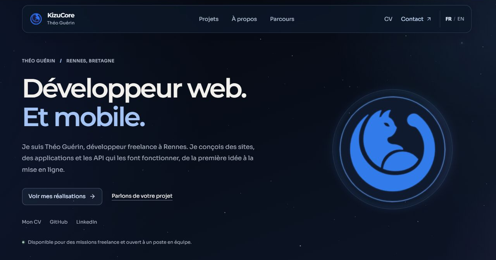

# Portfolio — Théo Guérin

Mon portfolio de développeur full-stack, basé à Rennes. J’y rassemble mes projets web et mobile, mon parcours et les services que je propose en freelance.

Le site est développé avec React et TypeScript, puis déployé sur Vercel.

**[Voir le portfolio →](https://theo-guerin.fr/fr)**

[](https://theo-guerin.fr/fr)

## Ce qu’on y trouve

- Mes réalisations, avec des filtres et des études de cas pour **La Marée Malouine**, **Les Portes de Montafilan** et **À table !**.
- Mon parcours, mes compétences et un CV consultable sur place ou téléchargeable en PDF.
- Des pages consacrées à mes prestations : sites internet, applications React et Flutter, API Django et Node.js.
- Un formulaire de contact avec envoi par e-mail et accusé de réception.

L’interface existe en français, en anglais et en breton. Les traductions disponibles dépendent des pages ; les services restent présentés en français. Il y a aussi quelques easter eggs à trouver.

## Stack

| Partie | Outils |
| --- | --- |
| Interface | React 18, TypeScript, React Router |
| Build | Vite |
| Styles et animations | Tailwind CSS 4, CSS, Framer Motion, tsParticles |
| Traductions | i18next, react-i18next |
| Contact | Fonctions Vercel, Resend, reCAPTCHA v3 |
| Tests et qualité | Node.js test runner, ESLint, TypeScript |

## Quelques choix de code

**Une organisation par fonctionnalité.** Les composants, hooks et styles d’une page restent dans le même dossier. Les données de profil, de projets et de CV sont séparées du rendu, dans `src/content`. Elles servent aussi à générer le contenu statique du site.

**Du HTML disponible avant React.** Le build génère un document HTML pour chaque route publique, avec son contenu, ses métadonnées et ses données structurées. React prend ensuite le relais pour les interactions. Le sitemap, les URL canoniques et les variantes de langue viennent d’une configuration commune.

**Les modules lourds chargent au moment utile.** Le lecteur PDF, les calendriers d’activité et les particules sont chargés à la demande. Le fond reste statique sur mobile et lorsque la réduction des animations est activée. Des contrôles sur le build suivent le poids des bundles et les imports différés.

**Le clavier fait partie du parcours.** Lien d’évitement, focus visible, navigation dans les onglets et restitution du focus à la fermeture des fenêtres : ces comportements sont pris en compte dans les composants.

**Les services tiers attendent le consentement.** Analytics démarre uniquement après accord, sur le domaine de production. reCAPTCHA est chargé séparément au moment de l’envoi du formulaire. L’API valide les champs, vérifie le captcha et applique une limitation simple par IP, en mémoire.

## Lancer le projet

Il faut **Node.js 24** et npm.

```bash
git clone https://github.com/KizuCore/Portfolio.git
cd Portfolio
npm ci
npm run dev
```

Vite affiche l’adresse locale dans le terminal. Les clés des services tiers ne sont pas nécessaires pour parcourir le site.

### Configurer le formulaire

Copier `.env.template` vers `.env`, puis renseigner les clés :

```env
VITE_RECAPTCHA_SITE_KEY=
RECAPTCHA_SECRET_KEY=
RECAPTCHA_MIN_SCORE=0.5
RESEND_API_KEY=
```

La clé `VITE_RECAPTCHA_SITE_KEY` est publique. Les secrets reCAPTCHA et Resend sont utilisés uniquement côté serveur.

Ces variables permettent également d’adapter le destinataire, l’expéditeur et l’URL du site :

```env
CONTACT_EMAIL=vous@example.com
RESEND_FROM=Portfolio <contact@votre-domaine.fr>
VITE_SITE_URL=https://votre-domaine.fr
```

En production, l’adresse d’expédition doit utiliser un domaine autorisé dans Resend. Les domaines utilisés pour le formulaire doivent aussi être autorisés dans reCAPTCHA.

`npm run dev` lance le frontend, pas les fonctions HTTP de `api/`. L’envoi d’e-mails se teste dans un environnement Vercel configuré avec ces variables.

## Repères dans le dépôt

```text
src/
  app/          Démarrage, routes, navigation et métadonnées
  features/     Pages, composants, hooks et styles par fonctionnalité
  shared/       UI, configuration et logique communes
  content/      Profil, projets, CV et contenus des services
  locales/      Traductions françaises, anglaises et bretonnes
  styles/       Styles globaux, polices et utilitaires
  assets/       Images et médias traités par Vite
api/            Fonctions HTTP Vercel
lib/            Validation serveur et modèles d’e-mails
public/         Ressources servies à URL fixe
scripts/        Génération du contenu et contrôles du build
tests/          Tests des API, du consentement, de la sécurité et du SEO
```

Pour modifier les projets, commencer par [`src/content/projects.ts`](src/content/projects.ts). Pour ajouter une page ou comprendre les règles d’import, voir le [guide d’architecture](docs/architecture.md).

Le sitemap et les fichiers de présentation Markdown dans `public/` sont générés au build : leurs sources se trouvent dans `src/content`, `src/locales` et `scripts`.

## Vérifier et compiler

```bash
npm run check              # ESLint, TypeScript, traductions et architecture
npm test                   # Tests automatisés
npm run build              # Sitemap, compilation et génération du HTML
npm run check:seo          # Contrôle les pages générées
npm run check:performance  # Vérifie les bundles et leur chargement
npm run preview            # Sert le build localement
```

Les deux contrôles `check:seo` et `check:performance` nécessitent un build préalable. Les tests utilisent des services simulés et n’envoient pas d’e-mails réels.

## Déploiement et sécurité

Le projet est prévu pour Vercel : commande de build `npm run build`, dossier de sortie `dist`, fonctions serveur dans `api/`. Les variables d’environnement sont à renseigner dans le projet Vercel.

[`vercel.json`](vercel.json) regroupe les redirections, le cache et les en-têtes de sécurité : CSP, HSTS, COOP et protection contre le clickjacking. Ces en-têtes ne sont pas appliqués par `vite preview`.

La CSP utilise une liste de sources autorisées et bloque les scripts inline ainsi que `eval`. Trusted Types reste en mode observation, car React Helmet et le lecteur PDF ne sont pas encore compatibles avec son blocage. HSTS inclut `includeSubDomains` et `preload` ; l’inscription dans la liste de préchargement des navigateurs reste une démarche séparée.

---

Développé par **Théo Guérin · KizuCore** — [Portfolio](https://theo-guerin.fr/fr) · [GitHub](https://github.com/KizuCore) · [LinkedIn](https://www.linkedin.com/in/theo-guerin35/)
